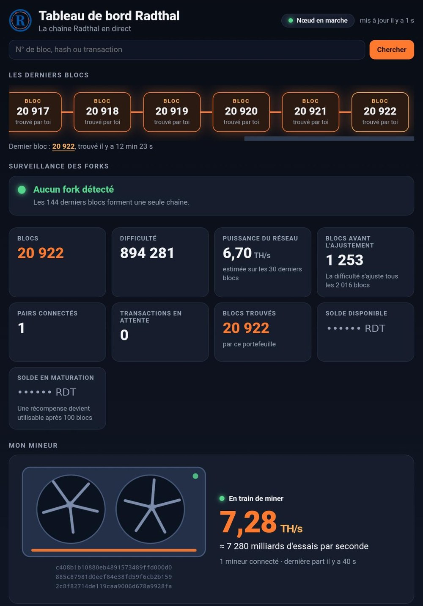
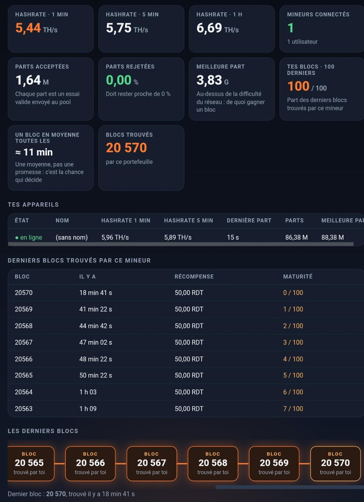
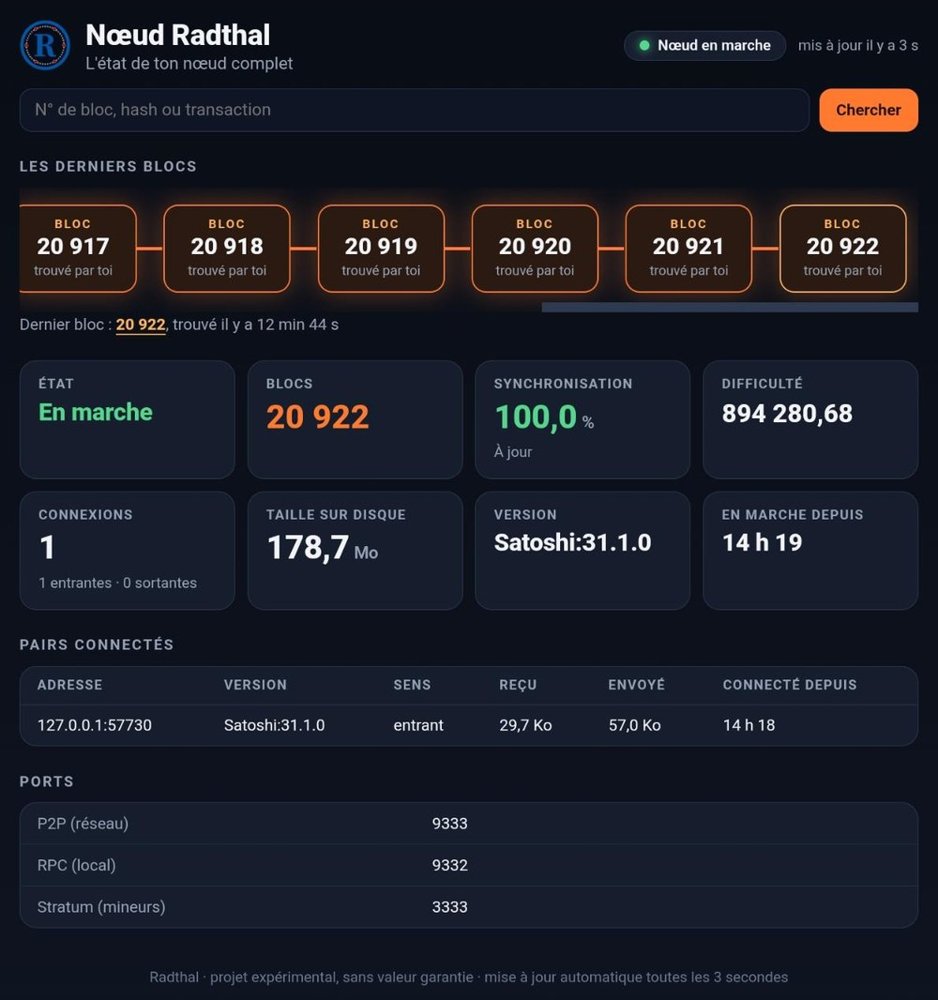
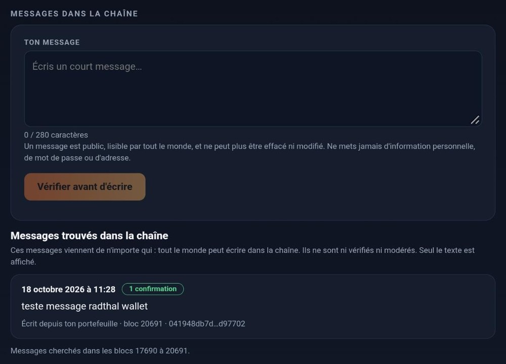
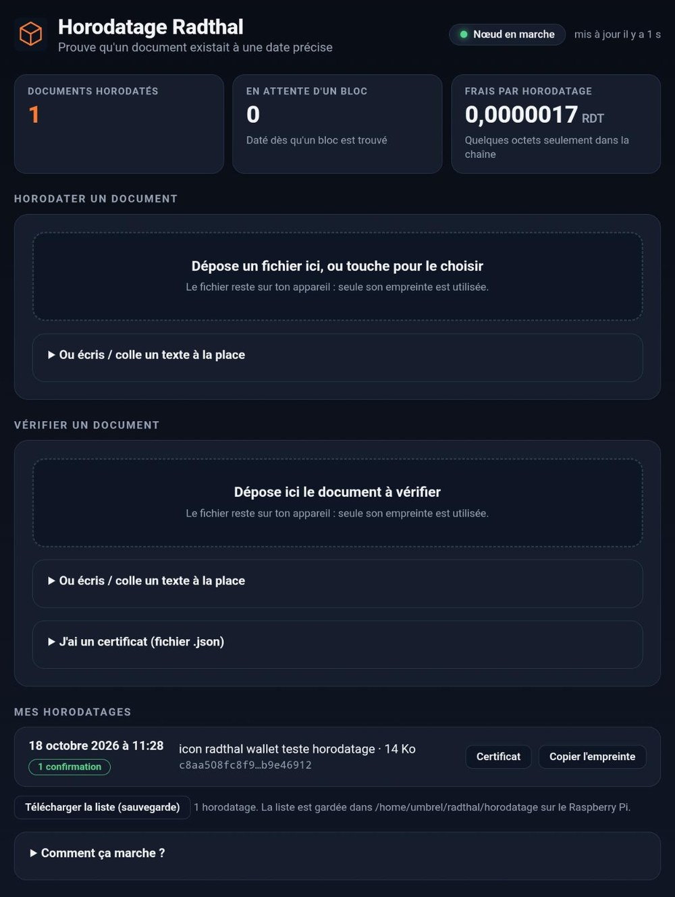

<p align="center">
  
</p>

<h1 align="center">Radthal</h1>

🇫🇷 [Version française](README.md) (the reference text: if the two ever differ, the French one wins) · 🌐 [Project website](https://bryancarterdouglas.github.io/radthal/)

Radthal is an experimental cryptocurrency: a **fork of Bitcoin Core v31.1** with Bitcoin's rules (SHA-256, difficulty retarget every
2016 blocks, 10-minute block target, halving every 210,000 blocks) and its own chain, with one open difference: a
[2% share for the creator](#the-developer-share-2) from block 25,000 on. This repository lets **anyone run a full node** and help the
network.

> A tinkerer's project, with no guarantee of any kind. Radthal has no connection with Bitcoin or the Bitcoin Core developers.
> See the [warnings](#warnings).

## Why Radthal?

On Bitcoin, a home miner has practically no chance of finding a block solo: the network is millions of times more powerful. Radthal
reuses the same rules on a new, tiny chain where **a single home miner still matters** and where everything can be observed up
close: a full node on a Raspberry Pi, a mining server, a wallet, alerts. It is a playground for experimenting and learning, **not an
investment**.

To understand the idea in pictures, see the [presentation video](https://youtu.be/20HJ0tP18fI) (in French, computer-generated voice).

What to know before getting interested:

- **The advantage is temporary.** If many miners arrive, the difficulty goes up and everyone's share goes down.
- **The network is small, hence fragile.** The checkpoint protects the history (see below), but it relies on trusting the project's
  creator: this is not as decentralized as Bitcoin.
- **2% of every block reward goes to the project's creator from block 25,000 on** (a rule announced in advance, see
  [The developer share](#the-developer-share-2)).
- **No value, no market, no promise.** Radthal is not an investment and must never be presented as one.

## Network parameters

| | |
|---|---|
| Code base | Bitcoin Core **v31.1** + `radthal.patch` |
| Mining algorithm | SHA-256 (Bitcoin ASICs work) |
| Magic bytes | `52 44 54 31` ("RDT1") |
| Network (P2P) port | **9333** |
| Addresses | bech32 `rdt1…` · base58: prefix 60 (addresses), 85 (scripts) |
| Genesis block | 2026-10-03 00:00 UTC · message "Radthal 03/Oct/2026 premier bloc" · nonce 2161066804 · reward 50 |
| Genesis hash | `00000000abe4c97c4b0efb25e556acfe8d76ffb08d2bbbe5bc5694f90459c198` |
| Genesis merkle root | `2ee4c2f3be7d69f29ad3245f440a3af80cb3a290b6c2390b84ae82b680ab0c1e` |
| Consensus differences | BIP34 active from block 17; SegWit and Taproot active from the start; no preconfigured "minimum work" or trusted block; **2% developer share from block 25,000** |
| Developer share | from block **25,000**: 2% of each block's reward goes to `rdt1qslzd9g3s34r7kc2pmhhvlv3uds37ddvvd5zuz6` (see [The developer share](#the-developer-share-2)) |
| Checkpoint | block **20,300**, hash `000000000000011f952520848001cef3f59c00afe6539290469827aefc1e77c3` (see [Protection against rewriting](#protection-against-rewriting-checkpoint)) |

The `radthal.patch` file is authoritative: it contains every change relative to Bitcoin Core v31.1.

## The developer share (2%)

**From block 25,000 on**, every block pays **2% of its reward** to the project creator's address: 1 RDT out of a block's 50 RDT
(the share then follows the halvings). The remaining 98% goes to the miner. The amount of RDT created per block does not change: the
share is taken out of the reward, nothing is added.

| | |
|---|---|
| Starts | block **25,000** (earlier blocks are unchanged) |
| Address | `rdt1qslzd9g3s34r7kc2pmhhvlv3uds37ddvvd5zuz6` |
| Amount | at least 2% of the block reward (excluding transaction fees) |

- **It is public and verifiable.** The rule is in `radthal.patch` (functions `GetDevFeeAmount` and `GetDevFeeScript`): from block
  25,000 on, a block whose first transaction (the "coinbase") does not pay this share is rejected by up-to-date nodes (error
  `bad-cb-devfee`). Every affected block therefore contains an output to this address, visible in the block explorer.
- **Update your node before block 25,000** (`git pull && docker compose up -d --build`, or the recipe in [MINER.en.md](MINER.en.md)).
  A node that is not up to date also accepts blocks without this share, which up-to-date nodes reject: it would end up on a
  different chain from the rest of the network.
- **If you mine with this repository's `ckpool`**, it pays the share by itself (it takes 2% of the total, fees included): just
  rebuild its image (see [MINER.en.md](MINER.en.md)). An old `ckpool` would produce blocks that get rejected from block 25,000 on.
- **If you use other mining software**, the coinbase must contain an output to the address above of at least the required amount.
  From block 25,000 on, `getblocktemplate` gives the script and the amount in the `devfee` field, and `coinbasevalue` includes this
  share.
- **Disagree with this rule?** Radthal is free software: you can keep the old version, but you will then follow your own chain,
  separate from this one.

## What you need

- A computer or Raspberry Pi running Linux with **Docker** (and the `docker compose` plugin) installed.
- 4 GB of RAM recommended for compiling (otherwise set `BUILD_JOBS=1` in `.env`) and a few GB of free space.
- An internet connection. The chain is still very small: syncing takes a few minutes.

## Installation

First time on Linux? The [beginner video tutorial](https://youtu.be/NB6UsRZOKIE) (in French: Linux, Umbrel, Docker, GitHub) shows all
the steps below, one by one.

```bash
git clone https://github.com/bryancarterdouglas/radthal.git
cd radthal
cp env.example .env
```

Open `.env` and replace `SEED_NODE` with the address of a running Radthal node (see "Known nodes" below).

```bash
docker compose up -d --build
```

The first time, Docker **compiles** Bitcoin Core: expect a few tens of minutes on a PC, over an hour on a Raspberry Pi. After that,
startup is immediate.

No computer at hand? An Android phone can also run a node that verifies the chain (it cannot be reached from outside): see
**[NOEUD-TELEPHONE.md](NOEUD-TELEPHONE.md)** (in French), a procedure tested on a single phone model.

## Check that it works

```bash
docker compose exec radthal radthal-cli getconnectioncount     # should print 1 or more
docker compose exec radthal radthal-cli getblockchaininfo       # "blocks" should climb, then follow the chain
docker compose exec radthal radthal-cli getblockhash 0          # should print the genesis hash above
```

If `getblockhash 0` prints anything other than the hash in the table, you are not on the right chain: do not go on.

Live logs: `docker compose logs -f radthal` (Ctrl+C to quit, the node keeps running).

## Create a wallet

```bash
docker compose exec radthal radthal-cli createwallet "mywallet"
docker compose exec radthal radthal-cli -rpcwallet=mywallet getnewaddress
```

The address you get starts with `rdt1`. **Back up your wallet** (`backupwallet`) and keep the copy somewhere other than the same
machine: if the disk dies, the coins are lost.

```bash
docker compose exec radthal radthal-cli -rpcwallet=mywallet backupwallet /data/backup.dat
docker compose cp radthal:/data/backup.dat ./backup.dat
```

## Receiving a payment: how many confirmations?

Every new block on top of a transaction is a "confirmation". The more there are, the harder it is to rewrite the transaction.
Cautious rules of thumb (assuming 10-minute blocks):

| Situation | Suggested confirmations |
|---|---|
| Test between friends, token amount | 10 (about 1 h 40) |
| An amount that matters | 100 (about 17 h) |
| A large amount, or paying for goods | 300 or more, or wait until the network has grown |

These numbers are not magic: as long as the network's total power is low, even 100 confirmations can be rewritten by someone with much
more power. They may come down as the network grows. Blocks you mine yourself can only be spent after 100 confirmations (Bitcoin rule).

To see where a payment stands:

```bash
docker compose exec radthal radthal-cli -rpcwallet=mywallet listtransactions "*" 5     # "confirmations" field
docker compose exec radthal radthal-cli -rpcwallet=mywallet gettransaction TRANSACTION_ID
```

## Monitoring and alerts

The `watch` service in `docker-compose.yml` starts with the node. It checks every 30 seconds (competing branches every 10 minutes if
`TIPS_CHECK_MINUTES` is above 0 in `.env`) and reports in the logs (`docker compose logs -f watch`):

- **no new block** for `STALL_MINUTES` (120 by default): the miner is off, ckpool crashed…
- **rewritten chain**: the latest blocks were replaced (alert from 2 blocks, "urgent" from 6);
- a **competing branch** of 2 blocks or more, or an **invalid block** rejected by the node;
- **isolated node** (0 connections for 15 minutes) or **unreachable node**.

To get alerts on your phone, install the free **ntfy** app, subscribe to a topic with a hard-to-guess name (for example
`radthal-3fa9c21b7d40`; it is public: anyone who knows the name can read it), then put
`NTFY_URL=https://ntfy.sh/radthal-3fa9c21b7d40` in `.env` and run `docker compose up -d` again. Test:

```bash
docker compose exec watch python /app/radthal_watch.py --test-notify
```

The search for competing branches asks the node for the list of **all** its dead branches. On a new node it is tiny and
`TIPS_CHECK_MINUTES=10` is perfect. On a node that mined its first blocks at difficulty 1 (thousands of blocks per second) it can
hold hundreds of thousands of lines, and each request makes the node's memory grow by about 300 MB without ever giving it back: in
that case set `TIPS_CHECK_MINUTES=0`. The script also turns itself off beyond 2,000 branches. The "rewritten chain" alert does not
depend on it.

The script (`watch/radthal_watch.py`, no dependencies) and its tests (`python3 -m unittest watch/test_radthal_watch.py`) are in this
repository. Monitoring **warns**, it prevents nothing: facing a real attack, what is needed is more honest mining power.

## Protection against rewriting (checkpoint)

Bitcoin Core removed its checkpoints; `radthal.patch` puts one back, in its simplest form: block **20,300** must have exactly the
hash in the table above, and once this block is known, no branch can attach below it. A competing chain, even a much more powerful
one, that does not go through this block can therefore no longer rewrite the earlier history. It can still rewrite what comes after:
the checkpoint protects the past, not the latest blocks.

Good to know:

- **It only protects nodes that have this version.** An older node would still follow an attacker's chain: update
  (`git pull && docker compose up -d --build`).
- **It is a trust rule**: the project's creator chooses which block is authoritative. This is a deliberate choice for a small chain.
- Headers your node already knows are never re-checked, so an update does not touch your existing chain.
- To move it forward later: change `RADTHAL_CHECKPOINT_HEIGHT` and `RADTHAL_CHECKPOINT_HASH` in `radthal.patch` (file
  `src/validation.cpp`) and recompile. Choose a block buried under at least 100 blocks, never one of the very latest.

Check that your node is on the right chain at this point (must print the hash in the table):

```bash
docker compose exec radthal radthal-cli getblockhash 20300
```

## Helping the network: open port 9333

By default your node connects to the others, but nobody can connect to it. To strengthen the network, forward **TCP port 9333** on
your router to your machine. Open **only** this port: never the RPC (8332 by default), which gives access to the wallet. Opening
the port makes your IP address visible to other nodes.

## Mining

Radthal uses SHA-256, like Bitcoin: a Bitcoin ASIC miner works. The more honest miners there are, the harder the chain is to
rewrite. The step-by-step guide (node + `ckpool` mining server) is in **[MINER.en.md](MINER.en.md)**.

## The interface (optional)

To follow and use their node without the command line, the author runs six small web pages on his Raspberry Pi (Umbrel).

**Four pages to look at**: **node**, **dashboard**, **mempool** and **ckpool**. They refresh every 3 seconds and are **read-only**:
they change nothing. These are real screenshots of a running node (balance hidden, local network address replaced). The miner's
animated fans are an illustration; the numbers come from the node and ckpool.

| Dashboard | ckpool (mining) | Node |
|:---:|:---:|:---:|
| <a href="docs/interface-tableau-de-bord.jpg"></a> | <a href="docs/interface-ckpool.jpg"></a> | <a href="docs/interface-noeud.jpg"></a> |

(Click an image to enlarge it.)

**Two pages that act**: once the wallet is protected, they ask for the wallet password at every action (the keys stay in the node,
the pages never see them):

- **Radthal Wallet**: balance, receiving address with QR code, sending RDT (preview then confirmation), history, backup, wallet
  password protection (do this before sending anything) and **messages in the chain**.
- **Radthal Horodatage** (timestamping): prove that a document existed, in this exact form, at the date of a block.

Timestamps and messages are written in the chain through a data output (`OP_RETURN`), which the node software accepts by default.
The author tried them end to end on his own node (send, confirmation in a block, verification).

| Radthal Wallet: messages | Radthal Horodatage |
|:---:|:---:|
| <a href="docs/interface-portefeuille-messages.jpg"></a> | <a href="docs/interface-horodatage.jpg"></a> |

(Screenshots of the author's node, on a phone, cropped: the wallet balance, address and QR code are not shown.)

*Timestamping.* The page computes the document's fingerprint (SHA-256) **in your browser**; the document never leaves your device and
only the fingerprint (36 bytes) is written in the chain, for about 0.0000017 RDT in fees. Once the block is found, you download a
certificate (a small `.json` file): with the exact document, it lets someone else verify the timestamp on their own node. What it
proves: an identical document existed no later than the block's date. What it does not prove: who wrote it, nor the exact time (a
block's time is set by its miner). The chain is small and the author's miner keeps it moving: for a real dispute, back the proof up
with a recognized service. Changing a single letter of the document changes the fingerprint.

*Messages.* You can write a short message (at most 280 characters) in the chain. **A message is public and permanent**: everyone
with a Radthal node can read it, nobody can erase or edit it. Never put anything personal in it. The page also shows the messages of
the last 3,000 blocks, written by anyone: they are neither verified nor moderated, and only the text is shown (never a clickable
link, image or code). Photos and videos do not fit: only a small amount of text can be written.

The files are in the **[Umbrel-radthal](https://github.com/bryancarterdouglas/Umbrel-radthal)** repository. They are made for the
author's setup and use files from his Raspberry Pi: this is **not** a one-click install for everyone. The pages are plain HTTP on the
local network: never expose them to the Internet. The Docker node in this repository does not need them.

## Known nodes

| Address | Note |
|---|---|
| `radthal-seed.duckdns.org:9333` | the creator's node |

Running a publicly reachable node? Open an "issue" so it can be added to the list.

## Update / stop

```bash
docker compose stop            # clean stop (the node saves its state)
docker compose up -d           # restart
git pull && docker compose up -d --build     # update from the repository
```

**Update before block 25,000**: the [developer share](#the-developer-share-2) then becomes a network rule, and a node that is not up
to date splits off from the others.

Your data (chain and wallet) is in the Docker volume `radthal_radthal-data` and survives updates.

## Troubleshooting

- **0 connections**: the `SEED_NODE` address is wrong or the node is offline. Check `docker compose logs radthal`.
- **The build stops silently or with "Killed"**: out of memory. Set `BUILD_JOBS=1` in `.env`.
- **`docker compose` not found**: install the Compose plugin, or use `docker-compose` (with a hyphen).
- **The node says "initial sync" although it is up to date, and no more blocks are mined**: the last block is more than 24 hours old
  (power cut, miner off…), and Bitcoin Core then refuses to hand out work to miners. The `docker-compose.yml` of this README already
  applies the `-maxtipage=315360000` setting. If you started your node by hand (see [MINER.en.md](MINER.en.md)), add
  `maxtipage=315360000` to its `bitcoin.conf` and restart it.

## Warnings

- Radthal is an experimental project, with no guaranteed value. Never promise anyone gains.
- A young chain with little mining power is fragile: a more powerful miner can rewrite the latest blocks.
- You alone are responsible for your keys and your backups.
- A message written in the chain is public and permanent. A Radthal timestamp does not replace a recognized service in a dispute.
- No relationship with Bitcoin or its developers. The code comes from [Bitcoin Core](https://github.com/bitcoin/bitcoin) (MIT
  license).

---

License: MIT (see `LICENSE`).
